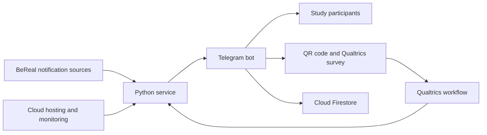

# BeReal Study Bot

An automated Telegram-based experience sampling system developed for my bachelor’s thesis. The system supported a field study examining how BeReal notifications affect ongoing social interactions.

> **Project status:** The study has concluded. All live services, credentials, monitoring systems, and data-collection infrastructure have been decommissioned. This repository is a privacy-safe portfolio version and contains no participant data or active credentials.

## Overview

The bot automated an experience sampling workflow around real-world BeReal notification moments. It registered participants, detected regional notification events, delivered short contextual surveys through Telegram, and stored responses securely for later analysis.

When participants were with other people, the system also generated a QR code linking to a separate bystander survey. This enabled the study to collect perspectives from both the primary participant and people physically present during the event.

## Key Features

- Telegram-based participant registration
- Support for multiple BeReal notification regions
- Automated survey delivery after notification events
- Interactive in-chat experience sampling questionnaires
- Context and social-composition questions
- QR-code generation for bystander surveys
- Qualtrics webhook integration
- Firestore-based participant and response storage
- Duplicate-response detection
- Participant progress tracking
- Automated eligibility and closing-interview flows
- Health endpoint for cloud deployment and monitoring
- Error handling and connection recovery

## System Architecture



## Technology Stack

- Python
- Telegram Bot API
- Firebase Admin SDK
- Cloud Firestore
- Qualtrics Workflows
- QR code generation
- HTTP webhooks
- Render
- UptimeRobot
- ntfy
- External BeReal notification API

## Configuration

The application was configured through environment variables rather than hard-coded credentials:

| Variable | Purpose |
| --- | --- |
| `BOT_TOKEN` | Telegram bot authentication token |
| `FIREBASE_CREDENTIALS` | Firebase service-account configuration |
| `DEVIN_API_KEY` | BeReal notification API authentication |
| `BYSTANDER_SURVEY_URL` | Base URL of the bystander survey |
| `CONTACT_EMAIL` | Public study contact address |
| `PORT` | Health-server port supplied by the hosting platform |

No production values are included in this repository.

## Data and Privacy

This repository does not contain participant responses, Telegram identifiers, usernames, email addresses, consent records, or database exports.

The public code has been separated from the original private development repository to prevent historical credentials or study materials from being exposed.

## Deployment Status

The original system was deployed as a cloud-hosted web service and monitored through an uptime-monitoring service. After completion and assessment of the thesis:

- The hosting service was removed.
- Monitoring was disabled.
- Survey collection and workflows were stopped.
- The Telegram bot was deleted.
- Firebase credentials were revoked.
- The Firebase and Google Cloud project was scheduled for deletion.

The repository is retained solely as a technical portfolio artifact.

## What I Learned

This project involved designing and operating a complete research system across multiple external services. Key areas of experience included:

- Event-driven application design
- Asynchronous Telegram bot development
- Cloud database integration
- Webhook-based communication
- Resilient long-running connections
- Privacy-aware research engineering
- Production deployment and monitoring
- Responsible infrastructure decommissioning

## Repository Structure

```text
.
├── main.py              # Main Telegram bot and study workflow
├── requirements.txt     # Python dependencies
├── .env.example         # Example configuration
├── .gitignore
└── README.md
```

## Disclaimer

This project is an independent academic research implementation and is not affiliated with or endorsed by BeReal, Telegram, Firebase, Qualtrics, Render, UptimeRobot, ntfy, or the external notification-data provider.
